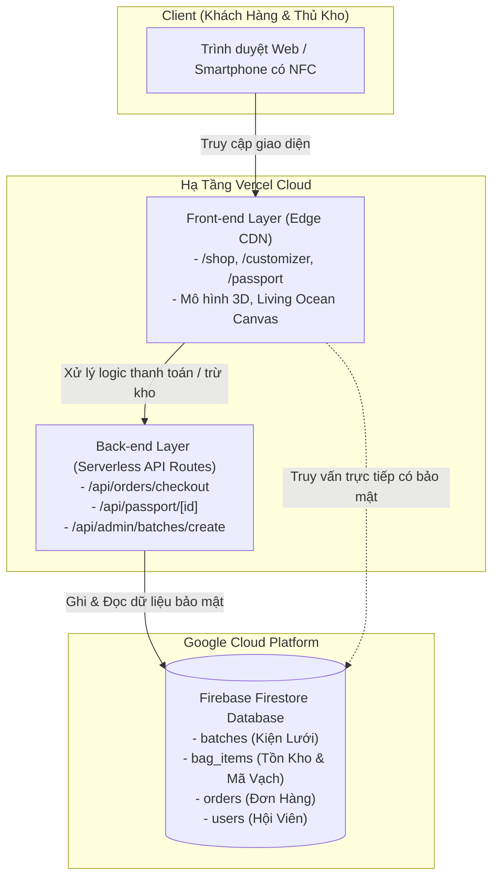

# HƯỚNG DẪN TRIỂN KHAI VERCEL, GITHUB, FIRESTORE & BẢO MẬT TRANG ADMIN
**Dự án: NÉT Ocean Eco-commerce & Chuỗi Cung Ứng Tuần Hoàn Lưới Ma**

---

## 1. TỔNG QUAN KIẾN TRÚC HỆ THỐNG

Dự án được xây dựng theo mô hình **Next.js 14 App Router Fullstack Monorepo**, kết hợp dịch vụ máy chủ đám mây không máy chủ (Serverless) và cơ sở dữ liệu thời gian thực:



> **Lưu ý**: Bạn **không cần tạo backend server riêng biệt** (như Node.js/Express riêng). Khi đưa mã nguồn lên Vercel, các route trong thư mục `src/app/api/` sẽ tự động trở thành các **Serverless Functions** hoạt động độc lập và tự động mở rộng theo lưu lượng truy cập.

---

## 2. QUY TRÌNH PUSH MÃ NGUỒN LÊN GITHUB

Mã nguồn dự án đã được kết nối với repository:  
`https://github.com/DucNgVan/VecomNet-s_Tsunami_Team.git` (nhánh `main`).

File `.gitignore` đã loại trừ `.env*.local`, `.next`, `node_modules` nên các khoá bí mật trên máy tính của bạn sẽ **không bao giờ bị lộ ra ngoài GitHub**.

### Các bước thực hiện:
Mở Terminal tại thư mục dự án và chạy các lệnh sau:

```bash
# 1. Kiểm tra các thay đổi mới
git status

# 2. Đưa toàn bộ các cập nhật vào khu vực chuẩn bị commit
git add .

# 3. Tạo commit với thông điệp rõ ràng
git commit -m "feat: complete supply chain OS, real warehouse database, NFC warranty claim, and admin dashboard"

# 4. Đẩy mã nguồn lên nhánh chính trên GitHub
git push origin main
```

---

## 3. CẤU HÌNH VERCEL (FRONT-END & BACK-END TỰ ĐỘNG)

Khi liên kết kho GitHub với Vercel:
1. Mỗi khi bạn chạy lệnh `git push origin main`, Vercel sẽ tự động phát hiện và kích hoạt chu trình **CI/CD Build & Deploy**.
2. **Cấu hình dự án trên Vercel** (thông số tiêu chuẩn):
   - **Framework Preset**: `Next.js`
   - **Build Command**: `npm run build`
   - **Output Directory**: `.next`
   - **Install Command**: `npm install`
   - **Node.js Version**: `18.x` hoặc `20.x`

---

## 4. CẤU HÌNH CƠ SỞ DỮ LIỆU FIRESTORE TRÊN VERCEL

Để hệ thống lưu trữ kho bãi và trừ hàng hoạt động thực tế trên máy chủ Vercel, bạn cần thực hiện 2 cấu hình sau:

### 4.1. Khai báo Biến môi trường (Environment Variables) trên Vercel:
1. Đăng nhập vào [vercel.com](https://vercel.com) ➔ Chọn dự án của bạn.
2. Điều hướng vào: **Settings** ➔ **Environment Variables**.
3. Điền các cặp khoá/giá trị (lấy từ file `.env.local` của bạn):

| Tên biến (Key) | Mục đích sử dụng |
| :--- | :--- |
| `NEXT_PUBLIC_FIREBASE_API_KEY` | Khoá API ứng dụng Firebase |
| `NEXT_PUBLIC_FIREBASE_AUTH_DOMAIN` | Tên miền xác thực người dùng |
| `NEXT_PUBLIC_FIREBASE_PROJECT_ID` | Mã định danh dự án Google Cloud |
| `NEXT_PUBLIC_FIREBASE_STORAGE_BUCKET` | Lưu trữ file phương tiện |
| `NEXT_PUBLIC_FIREBASE_MESSAGING_SENDER_ID` | Mã nhận diện dịch vụ Cloud Messaging |
| `NEXT_PUBLIC_FIREBASE_APP_ID` | ID ứng dụng web Firebase |
| `NEXT_PUBLIC_FIREBASE_MEASUREMENT_ID` | Mã phân tích dữ liệu Google Analytics |

4. Chọn áp dụng cho cả 3 môi trường: **Production**, **Preview**, và **Development** ➔ Nhấn **Save**.
5. Vào tab **Deployments** ➔ Bấm nút `...` ở bản build mới nhất ➔ Chọn **Redeploy** để Vercel tải các biến mới.

### 4.2. Cấu hình Security Rules trên Firebase Console:
Truy cập [Firebase Console](https://console.firebase.google.com/) ➔ Chọn dự án ➔ **Firestore Database** ➔ Tab **Rules**, dán đoạn quy tắc sau để tránh bị Firebase khoá sau 30 ngày (test mode):

```javascript
rules_version = '2';
service cloud.firestore {
  match /databases/{database}/documents {
    // 1. Cho phép đọc công khai Kiện Lưới & Túi Thành Phẩm để khách quét NFC xem Passport
    match /batches/{batchId} {
      allow read: if true;
      allow write: if true; // Quản trị viên cập nhật mẻ lưới
    }
    match /bag_items/{itemId} {
      allow read: if true;
      allow write: if true; // Khách hàng kích hoạt bảo hành NFC hoặc hệ thống trừ kho
    }

    // 2. Cho phép ghi đơn hàng khi khách hàng thanh toán
    match /orders/{orderId} {
      allow read, create: if true;
      allow update, delete: if true;
    }

    // 3. Thông tin người dùng & Tủ đồ kỷ vật cá nhân
    match /users/{userId} {
      allow read, write: if true;
    }
  }
}
```

---

## 5. GIẢI PHÁP VỊ TRÍ & BẢO MẬT TRANG ADMIN

### Hiện trạng:
- Trang Admin nằm tại đường dẫn: `https://<domain-cua-ban>/admin`
- Trang Đăng nhập quản trị: `https://<domain-cua-ban>/admin/login`

### So sánh 3 giải pháp triển khai:

| Tiêu chí | Giải pháp 1: Route Guard + Master Key (Khuyên Dùng) | Giải pháp 2: Tách Subdomain Riêng (`admin.domain.com`) | Giải pháp 3: Đổi Đường Dẫn Ẩn Danh (`/portal-ops-xyz`) |
| :--- | :--- | :--- | :--- |
| **Cách thức** | Giữ route `/admin`, khoá bằng Auth Guard | Trỏ DNS subdomain riêng trên Vercel | Đổi tên thư mục `src/app/admin` thành tên bí mật |
| **Bảo mật** | Chặn bằng mật khẩu Master Key + Role Firebase | Tách biệt hoàn toàn cổng người dùng | Khách lạ và bot không quét được URL |
| **Tính thuận tiện**| Dễ demo pitching, không cần cấu hình tên miền | Rất chuyên nghiệp khi đã có tên miền chính thức | Cần nhớ đường dẫn bí mật |
| **Mức độ khuyên dùng**| ⭐⭐⭐⭐⭐ (Tối ưu nhất cho MVP & Thi đấu) | ⭐⭐⭐⭐ (Dành cho bản thương mại hóa) | ⭐⭐⭐ (Thích hợp bảo mật nội bộ) |

### Cơ chế bảo vệ đã tích hợp sẵn trong mã nguồn:
1. **Ẩn hoàn toàn khỏi thanh điều hướng (Navbar)**: Khách hàng mua sắm thông thường không thấy bất kỳ nút bấm hay liên kết nào dẫn tới `/admin`.
2. **Khóa truy cập tự động (Auth Guard)**: Bất kỳ ai gõ trực tiếp `/admin` mà chưa xác thực sẽ gặp màn hình khóa **"YÊU CẦU QUYỀN ĐIỀU HÀNH"**.
3. **Mã bảo mật Quản trị viên (Master Key)**:
   - Truy cập vào `/admin/login`
   - Nhập Master Key: `NET-OCEAN-ADMIN-2024` (hoặc sử dụng nút tiện ích *"Nạp Khóa Demo"* để đăng nhập nhanh 1 chạm khi thuyết trình).

---

## 6. CHECKLIST KIỂM THỬ SAU KHI DEPLOY VERCEL

- [ ] **Kiểm tra Giao diện Khách hàng**: Vào trang chủ, xem mô hình 3D túi và charm, kiểm tra giỏ hàng.
- [ ] **Kiểm tra Trừ Kho Tự Động**: Đặt 1 đơn hàng tại `/checkout` ➔ Vào `/admin?tab=inventory` kiểm tra xem số lượng **"Còn Tồn Kho (In Stock)"** có tự động giảm đi 1 sản phẩm hay không.
- [ ] **Kiểm tra Xuất File Excel**: Tại tab Kho Thành Phẩm, bấm nút **"📥 Xuất File Excel (CSV)"** ➔ Mở file bằng Excel kiểm tra tiếng Việt có dấu và các trường dữ liệu.
- [ ] **Kiểm tra Đồng Bộ Firestore**: Bấm nút **"⚡ Đồng Bộ Cloud Firestore"** ➔ Xác nhận thông báo màu xanh báo thành công.
- [ ] **Kiểm tra Chạm Chip NFC**: Truy cập đường dẫn Passport mô phỏng NFC ➔ Thử nhập Họ Tên & SĐT để kích hoạt bảo hành 24 tháng ➔ Xác nhận thẻ chuyển sang trạng thái Vàng Kim chính chủ.
