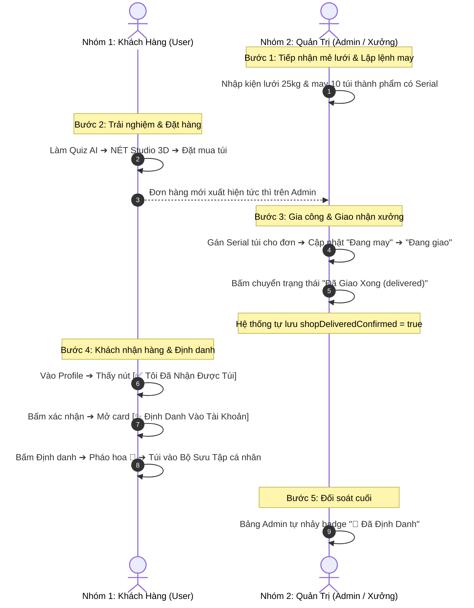

# 📘 VĂN BẢN HƯỚNG DẪN KIỂM THỬ DÀNH CHO TEAM TEST (TESTING TEAM HANDBOOK)
**Dự án:** NÉT - Sáng Tạo Sinh Thái Từ Lưới Ma (Eco Net Craft & Digital Story Passport)  
**Phiên bản hệ thống:** v1.0.0-production-ready  
**Ngày ban hành:** 14/10/2026  
**Mục tiêu:** Cung cấp quy trình, kịch bản phối hợp và tiêu chuẩn nghiệm thu dành cho Team Test khi tiến hành kiểm thử thực tế trên hệ thống.

---

## 👥 1. MÔ HÌNH PHÂN CÔNG NHÂN SỰ (PAIR-TESTING: 2 NHÂN SỰ / NHÓM)

Để đảm bảo tính khách quan và phát hiện triệt để lỗi logic, đợt kiểm thử được chia thành **2 Nhóm độc lập (mỗi nhóm gồm 2 nhân sự)** phối hợp theo mô hình **Driver & Observer**:

```
┌────────────────────────────────────────────────────────┐
│                   TEAM LEADER / QA LEAD                │
│       (Điều phối chung, tổng hợp Bug & Nghiệm thu)     │
└───────────────────────────┬────────────────────────────┘
                            │
            ┌───────────────┴───────────────┐
            ▼                               ▼
┌───────────────────────────────┐ ┌───────────────────────────────┐
│  NHÓM 1: KHÁCH HÀNG (USER)    │ │    NHÓM 2: QUẢN TRỊ (ADMIN)   │
│  Phụ trách: TEST_CHECKLIST_USER│ │  Phụ trách: TEST_CHECKLIST_ADMIN│
├───────────────────────────────┤ ├───────────────────────────────┤
│ • Nhân sự 1A (Driver - Thao tác)│ │ • Nhân sự 2A (Driver - Thao tác)│
│ • Nhân sự 1B (Observer - Soát log)│ • Nhân sự 2B (Observer - Soát log)│
└───────────────────────────────┘ └───────────────────────────────┘
```

### 1.1. Phân định vai trò trong mỗi nhóm:
- **Nhân sự A (Driver - Người thực thi):**
  - Trực tiếp click chuột, nhập liệu, tương tác trên giao diện trình duyệt.
  - Đi đúng theo từng bước (Step-by-step) của bảng kịch bản kiểm thử.
- **Nhân sự B (Observer / Reviewer - Người giám sát & Ghi nhận):**
  - Theo dõi màn hình của Driver, đối chiếu kết quả thực tế với "Kết quả kỳ vọng".
  - Mở tab Console (`F12`) để bắt các lỗi đỏ (Runtime Errors / 404 / 500).
  - Đánh dấu trạng thái `[x]` vào file checklist và viết báo cáo lỗi (Bug Report) nếu phát hiện sai lệch.

---

## 🛠️ 2. CHUẨN BỊ MÔI TRƯỜNG & THIẾT BỊ KIỂM THỬ

### 2.1. Địa chỉ truy cập hệ thống:
- **Nhóm 1 (User):** `http://localhost:3000/` (Giao diện khách hàng).
- **Nhóm 2 (Admin):** `http://localhost:3000/admin` (Trang quản trị & chuỗi cung ứng).

### 2.2. Thiết bị & Trình duyệt:
- Khuyến nghị sử dụng **Google Chrome**, **Safari** hoặc **Microsoft Edge** phiên bản mới nhất.
- Bật sẵn cửa sổ kiểm tra lập trình: Bấm phím `F12` (hoặc chuột phải chọn `Inspect` ➔ Tab **Console** và Tab **Network**) để theo dõi tín hiệu API và Firestore.
- Chuẩn bị 01 tài khoản Google hoặc tạo tài khoản mới trên trang để kiểm thử luồng Thành viên.

---

## 🔄 3. KỊCH BẢN PHỐI HỢP THỜI GIAN THỰC GIỮA 2 NHÓM (CROSS-TESTING MATRIX)

Hệ thống NÉT là chuỗi cung ứng tuần hoàn khép kín, do đó hai nhóm **bắt buộc phải tương tác chéo** theo kịch bản 8 bước chuẩn sau đây:



### Chi tiết các mốc phối hợp:
1. **Khởi động:** Nhóm Admin thực hiện **Reset kho** về mẻ lưới thực nghiệm ban đầu và xóa database túi đã định danh cũ để đảm bảo môi trường kiểm thử sạch 100%.
2. **Cung ứng:** Nhóm Admin tạo mẻ lưới và chạy lệnh cắt may thành phẩm để tạo ra các mã Serial có sẵn trong kho.
3. **Mua hàng:** Nhóm User vào NÉT Studio 3D hoặc Shop để tạo đơn hàng mới (COD hoặc VietQR).
4. **Xử lý đơn:** Nhóm Admin vào tab `Đơn Hàng`, kiểm tra đơn mới, kiểm tra mã Serial được gán, chuyển tiến độ sang `delivering` rồi `delivered`.
5. **Xác nhận 2 chiều:** Nhóm User vào trang `/profile`, kiểm tra nút **`[✅ Tôi Đã Nhận Được Túi]`**, bấm xác nhận để mở liên kết định danh.
6. **Định danh số:** Nhóm User bấm **`[✨ Định Danh Vào Tài Khoản]`**, quan sát túi xuất hiện trong Bộ Sưu Tập và số liệu môi trường (rác, san hô, CO₂) tăng lên.
7. **Đối soát:** Nhóm Admin kiểm tra lại bảng đơn hàng thấy trạng thái chuyển thành **`👜 Đã Định Danh`**.

---

## 📑 4. TÀI LIỆU CHECKLIST CHI TIẾT DÀNH CHO TỪNG NHÓM

Mỗi nhóm mở đúng file tài liệu kiểm thử của mình trong thư mục `docs/`:

### 4.1. Nhóm 1: Tài Liệu Kiểm Thử Khách Hàng (User)
- 📄 **File thực thi:** [`docs/TEST_CHECKLIST_USER.md`](file:///Users/3o/Documents/Study/Vecomnets/docs/TEST_CHECKLIST_USER.md)
- **Tổng số Test Cases:** **41 bước**
- **Nội dung bao gồm:**
  - Giai đoạn 1: Trang chủ & Thống kê sinh thái (`/`)
  - Giai đoạn 2: Trắc nghiệm AI Storytelling (`/quiz` / `/story`)
  - Giai đoạn 3: NÉT Studio 3D (xoay mô hình, chọn dáng túi, đổi màu, gắn charm, tính giá)
  - Giai đoạn 4: Cửa hàng & Giỏ hàng Drawer (`/shop`)
  - Giai đoạn 5: Đặt hàng COD & VietQR tự động (`/checkout`)
  - Giai đoạn 6: Trang Cảm ơn & Điều hướng Profile (`/order-success`)
  - Giai đoạn 7: Hồ sơ cá nhân, Xác nhận nhận hàng & Định danh túi (`/profile`)
  - Giai đoạn 8: Hải đồ GPS & NÉT Story Passport (`/passport/[batchId]`)

### 4.2. Nhóm 2: Tài Liệu Kiểm Thử Quản Trị & Xưởng May (Admin)
- 📄 **File thực thi:** [`docs/TEST_CHECKLIST_ADMIN.md`](file:///Users/3o/Documents/Study/Vecomnets/docs/TEST_CHECKLIST_ADMIN.md)
- **Tổng số Test Cases:** **33 bước**
- **Nội dung bao gồm:**
  - Giai đoạn 1: Dashboard KPI & Smart Alerts (`/admin`)
  - Giai đoạn 2: Tiếp nhận kiện lưới ma thô (Pack ID, GPS, khối lượng thực)
  - Giai đoạn 3: Lệnh cắt may xưởng (**Quy tắc: Kho thành phẩm sinh ra từ mẻ lưới, không nhập ở trang mẫu mã**)
  - Giai đoạn 4: Kho thành phẩm có Serial, Barcode 128 & Xuất CSV kiểm kê
  - Giai đoạn 5: Quản lý đơn hàng, Gán túi, Xác nhận Shop đã giao (`delivered`) & Copy link định danh
  - Giai đoạn 6: Quản lý Mẫu mã bộ sưu tập (Chỉ định nghĩa kiểu dáng & giá, **không có ô nhập số lượng**)
  - Giai đoạn 7: Công cụ Reset Database & Xóa dữ liệu túi đã định danh

---

## 🐞 5. QUY CHUẨN GHI NHẬN LỖI (BUG REPORTING STANDARD)

Khi phát hiện bất kỳ điểm sai lệch nào giữa **Kết quả thực tế** và **Kết quả kỳ vọng**, Observer của nhóm đó ghi nhận theo mẫu chuẩn sau:

```markdown
### [BUG-ID] Tiêu đề ngắn gọn mô tả lỗi
- **Người báo cáo:** [Tên Tester]
- **Mức độ (Severity):** [Blocker / Major / Minor / Trivial]
- **Nhóm thực hiện:** [Nhóm User / Nhóm Admin]
- **Mã Test Case liên quan:** [VD: TC-U-31 hoặc TC-A-12]
- **Đường dẫn màn hình (URL):** [VD: http://localhost:3000/profile]

#### 1. Các bước tái hiện (Steps to Reproduce):
1. Đăng nhập tài khoản user `abc@gmail.com`.
2. Vào trang /profile.
3. Bấm vào nút "Tôi Đã Nhận Được Túi".

#### 2. Kết quả thực tế (Actual Result):
- Nút bấm không phản hồi, mở Console F12 thấy báo lỗi đỏ: `ReferenceError...`

#### 3. Kết quả kỳ vọng (Expected Result):
- Hiển thị toast "Xác nhận thành công" và mở card định danh túi viền xanh ngọc.

#### 4. Hình ảnh / Video bằng chứng (Screenshot / Log):
- [Đính kèm ảnh chụp màn hình hoặc copy paste log lỗi Console vào đây]
```

### Bảng phân loại mức độ nghiêm trọng (Severity):
| Mức độ | Định nghĩa | Hành động |
| :--- | :--- | :--- |
| **Blocker (Chặn)** | Ứng dụng bị sập, trắng trang, không thể tiếp tục luồng (VD: Không thanh toán được, không thể claim túi). | Cần báo Developer sửa ngay lập tức. |
| **Major (Lớn)** | Tính năng cốt lõi chạy sai nghiệp vụ (VD: Trừ sai số kg lưới, sai số tiền, sai mã Serial). | Cần ưu tiên xử lý trong ngày. |
| **Minor (Nhỏ)** | Lỗi giao diện, tràn chữ, sai chính tả, hiệu ứng chuyển động bị giật lag. | Sửa trong đợt tinh chỉnh UI. |
| **Trivial (Góp ý)** | Đề xuất tối ưu trải nghiệm (UX) để thao tác tiện lợi hơn. | Ghi nhận vào backlog cải tiến. |

---

## ✅ 6. TIÊU CHUẨN ĐẠT NGHIỆM THU (DEFINITION OF DONE)

Một đợt kiểm thử được công nhận là **ĐẠT CHUẨN (PASS)** khi thỏa mãn tất cả các điều kiện sau:
1. **Tỷ lệ Pass:** Đạt **100% các Test Case cốt lõi** trong cả 2 file `TEST_CHECKLIST_USER.md` và `TEST_CHECKLIST_ADMIN.md`.
2. **Không có lỗi nghiêm trọng:** Có **0 lỗi Blocker** và **0 lỗi Major** chưa được khắc phục.
3. **Quy trình 2 chiều thông suốt:** Đơn hàng từ lúc tạo ➔ Xưởng may ➔ Shop giao ➔ Khách nhận ➔ Định danh túi ➔ Túi vào Bộ sưu tập và cập nhật chỉ số môi trường diễn ra trơn tru mà không cần F5 trình duyệt.
4. **Đồng bộ cơ sở dữ liệu:** Dữ liệu trên LocalStorage và Cloud Firestore hoàn toàn trùng khớp.

---

## 📞 HỖ TRỢ KỸ THUẬT KHI TEST
Nếu Team Test gặp vướng mắc kỹ thuật hoặc cần reset dữ liệu khẩn cấp, vui lòng liên hệ:
- **Kỹ thuật viên / Developer phụ trách:** Antigravity AI Pair Programmer
- **Lệnh kiểm tra hệ thống nhanh:** `npx tsc --noEmit && npm run build`
