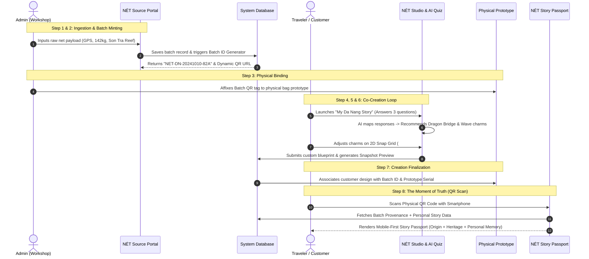

# NÉT — Eco-Luxury Sustainable Fashion-Tech MVP
## Product Requirements Document (PRD), Technical System Architecture & 3-Minute Pitch Script

---

# PART 1: PRODUCT STRATEGY & PRD SUMMARY

## 1. Executive Summary & Strategic Positioning

### 1.1 Brand Identity & Problem Statement
**NÉT** (Vietnamese for "feature", "cultural stroke", and a bilingual wordplay on ocean fishing "net") is an eco-luxury fashion-tech platform transforming marine plastic waste—specifically abandoned, lost, or discarded fishing gear ("ghost nets") from Vietnamese coastal waters—into personalized, culturally rooted souvenir bags and interactive digital assets.

**The Market Paradox:**
1. **The Environmental Crisis:** Over 640,000 tons of ghost fishing nets entangle coral reefs and kill marine life annually. Vietnam's vibrant coastal regions (Da Nang, Phu Quoc, Con Dao) struggle with marine debris that takes up to 600 years to decompose.
2. **The Tourism Souvenir Gap:** Da Nang welcomes over 7 million visitors each year, yet more than 85% of tourist souvenirs consist of generic, imported mass-market plastic trinkets lacking emotional resonance, authentic provenance, or environmental accountability.
3. **The "Greenwashing" Cynicism:** Conscious modern travelers (Gen Z & Millennials) demand authentic transparency. Generic "eco-friendly" labels on retail tags fail to convince buyers without verifiable origin proof.

### 1.2 The Innovation
NÉT establishes a **"Phygital Circular Souvenir"** paradigm combining three fundamental digital pillars:
- **Pillar 1: Traceable Raw Material Data.** Physical ghost nets retrieved by dive teams are digitized into serialized raw-material batch records at the source with GPS coordinates, salvage weight, and ocean sector data.
- **Pillar 2: Customer Co-Creation.** Moving away from passive e-commerce catalogs into an interactive co-design studio where travelers personalize their bag using culturally iconic charms.
- **Pillar 3: Unique Digital Story Passport.** Every individual product carries a permanently minted, dynamic QR code that opens an authenticated Story Passport detailing the net's underwater origin, local heritage, and the customer's personal creative memory.

---

## 2. Core Functional MVP Scope

To maximize velocity and deliver an unshakeable pitch demonstration, the MVP scope is strictly restricted to **four core functional modules**:

```
┌────────────────────────────────────────────────────────────────────────┐
│                        NÉT MVP SYSTEM BOUNDARY                         │
├───────────────────────┬────────────────────────────────────────────────┤
│ Module 1: NÉT Studio  │ 2D Snap-to-Mesh Configurator (1 Base + 6 Charms)│
├───────────────────────┼────────────────────────────────────────────────┤
│ Module 2: Da Nang AI  │ 3-Question Emotional Co-Creation Recommender   │
├───────────────────────┼────────────────────────────────────────────────┤
│ Module 3: NÉT Source  │ Internal Admin Net Ingestion & Batch ID Minting│
├───────────────────────┼────────────────────────────────────────────────┤
│ Module 4: Passport    │ Mobile-First Physical-to-Digital Story Portal  │
└───────────────────────┴────────────────────────────────────────────────┘
```

### Module 1: NÉT Studio (2D Product Configurator)
* **Objective:** Allow customers to visually compose and customize their physical net bag.
* **Functional Requirements:**
  1. **Base Bag Canvas:** Render 1 signature handcrafted upcycled net tote bag with realistic woven texture and predefined mesh knot coordinates (`#A1` through `#D8`).
  2. **Charm Tray (5–6 Heritage Assets):**
     - *Dragon Bridge Fire Charm* (Biomorphic recycled bronze/brass).
     - *Nam Ô Cresting Wave Charm* (Ocean sea-glass resin).
     - *Son Tra Red-Shanked Douc Langur* (Eco-enamel marine alloy).
     - *Ocean Tear Droplet* (Tumbled beach glass).
     - *Fisherman’s Reef Knot* (Braided upcycled nylon monofilament).
     - *Sunken Coral Rebirth* (Recycled bio-composite).
  3. **Snap-to-Mesh Logic:** Interactive click/drag snapping that anchors charms directly to structural knot intersection points, preventing overlapping and ensuring mechanical feasibility for local workshop artisans.
  4. **Live Visual Preview & Snapshot Generation:** Instant high-resolution 2D render and technical blueprint export detailing coordinates (`#B2`, `#C4`) for workshop assembly.

### Module 2: "My Da Nang Story" (AI-Driven Interactive Quiz)
* **Objective:** Eliminate "blank canvas syndrome" by guiding travelers through a 3-question emotional journey that algorithmically curates charm combinations.
* **The 3-Question Framework:**
  1. *Question 1 (Emotional Vibe):* "What feeling calls you toward the Da Nang coastline?"
     - Options: *Serene Solitude* | *Mythic Energy* | *Ocean Conservation* | *Vibrant Discovery*
  2. *Question 2 (Sensory Memory):* "Which moment along these waters left an indelible mark on you?"
     - Options: *Golden sunrise over My Khe beach* | *The fiery roar of the Dragon Bridge* | *The pristine coral diving banks of Son Tra* | *The rhythmic dance of traditional basket boats*
  3. *Question 3 (Personal Intention):* "What energy do you want your bespoke souvenir to carry home?"
     - Options: *Resilience & Grounding* | *Joy & Transformation* | *Guardianship of the Oceans* | *Wanderlust & Freedom*
* **AI Recommendation Engine Logic:**
  - Evaluates the 3-answer vector and scores the charm catalog against aesthetic weight and narrative affinity.
  - Automatically recommends a 2-to-3 charm configuration with suggested grid coordinates.
  - Generates a bespoke 2-sentence poetic dedication rendered inside the final Story Passport.
  - Provides a single-click CTA: `[Apply Design to NÉT Studio]`.

### Module 3: NÉT Source (Internal Admin Net Ingestion Portal)
* **Objective:** Enable workshop and field teams to log reclaimed ghost net batches directly into the system, initiating the chain of custody.
* **Input Fields:**
  - `Batch Collection Date` (Timestamp)
  - `Coastal Sector / GPS Coordinates` (e.g., *Son Tra Reef, DN-16.1024, 108.2611*)
  - `Salvage Diver Unit / Partner NGO` (e.g., *Da Nang Marine Volunteer Divers*)
  - `Reclaimed Net Weight (kg)` (e.g., *142.5 kg*)
  - `Material Polymer Type` (Polyamide Nylon-6 / High-Density Polyethylene)
  - `Primary Colorway` (Deep Sea Abyss Blue / Emerald Coral Green / Salt-Bleached Pearl)
  - `Assigned Physical Prototype SKU` (e.g., *NET-PROTO-DN-01*)
* **Batch ID Generation Engine:**
  - Automated algorithmic syntax: `NET-DN-[YYYYMMDD]-[HEX_COUNTER]` (e.g., `NET-DN-20241010-82A`).
  - Automatically pre-populates dynamic QR code destination URL: `https://net.eco/passport/NET-DN-20241010-82A`.

### Module 4: NÉT Story Passport (Mobile-First Landing Page)
* **Objective:** Deliver the emotional, verifiable digital experience upon scanning the physical bag's woven QR label.
* **Core Page Sections:**
  1. **Hero Provenance Badge:** Batch ID, unique item serial number, and verified "Ocean Heritage Certificate".
  2. **Raw Material Origin Map:** Interactive map pinpointing the salvage reef off Son Tra, retrieval date, salvage depth, and volunteer diver notes.
  3. **Local Cultural Narrative:** The heritage story of Da Nang's fishing villages and how traditional fishnet weaving was repurposed into eco-luxury accessories.
  4. **Personal Co-Creation Chapter:** The customer's selected charms, their quiz responses, personalized poetic dedication, and creation timestamp.
  5. **Batch Environmental Impact Scorecard:**
     - Plastic removed from ocean: *e.g., 0.85 kg ghost net*.
     - Equivalent marine habitat protected: *~2.4 m² coral reef surface*.
     - Carbon reduction metric: *1.6 kg CO2e avoided*.

---

## 3. Explicit MVP Boundary: Out-of-Scope Roadmap

The following modules are strictly **Out-of-Scope** for implementation in the live MVP code and are reserved for future roadmap stages (demonstrated via UI wireframe cards in pitch decks):
1. **Partner & Diver B2B Portal:** Self-service portal for third-party NGOs and waste collectors. *(Roadmap: Phase 2)*
2. **National Travel Passport:** Multi-destination cross-city passport (Hoi An, Nha Trang, Phu Quoc). *(Roadmap: Phase 2)*
3. **Enterprise CRM & Omnichannel Loyalty:** Loyalty points, member accounts, tiered club status. *(Roadmap: Phase 3)*
4. **Macro Impact Analytics Dashboard:** Aggregate city-level ESG statistics for institutional buyers. *(Roadmap: Phase 3)*
5. **Dynamic Algorithmic Pricing Engine:** Fluctuation based on global recycled polymer indices. *(Roadmap: Phase 3)*

---

# PART 2: TECHNICAL SYSTEM ARCHITECTURE & WORKFLOW LOGIC

## 1. System Architecture Overview

The MVP architecture is built on **Next.js 14 App Router**, combining server-side rendering for instant mobile QR scans with dynamic client-side 2D Canvas interaction for the configurator:

```
┌────────────────────────────────────────────────────────────────────────┐
│                           CLIENT APPLICATIONS                          │
│   ┌───────────────────────────────┐  ┌──────────────────────────────┐  │
│   │     Internal Admin (Web)      │  │    Customer Journey (Web)    │  │
│   │    - Batch Ingestion Form     │  │    - 3-Question AI Quiz      │  │
│   │    - Batch ID & QR Generator  │  │    - 2D Snap Studio Canvas   │  │
│   └───────────────┬───────────────┘  │    - Mobile Story Passport   │  │
│                   │                  └──────────────┬───────────────┘  │
└───────────────────┼─────────────────────────────────┼──────────────────┘
                    │ REST / Server Actions           │ REST / Actions
┌───────────────────▼─────────────────────────────────▼──────────────────┐
│                     NEXT.JS 14 APPLICATION LAYER                       │
│  ┌──────────────────────┐ ┌───────────────────┐ ┌───────────────────┐  │
│  │ Batch Management API │ │ Quiz & Rec Engine │ │ Passport Resolver │  │
│  │ /api/net-source      │ │ /api/story/quiz   │ │ /passport/[id]    │  │
│  └──────────┬───────────┘ └─────────┬─────────┘ └─────────┬─────────┘  │
└─────────────┼───────────────────────┼─────────────────────┼────────────┘
              │                       │                     │
┌─────────────▼───────────────────────▼─────────────────────▼────────────┐
│                       PERSISTENCE & DATA STORAGE                       │
│  ┌──────────────────┐  ┌────────────────────┐  ┌────────────────────┐  │
│  │  Batches Store   │  │ Configurations DB  │  │   Canvas Assets    │  │
│  │ (Provenance Data)│  │ (Snap Coordinates) │  │  (Snapshot WebP)   │  │
│  └──────────────────┘  └────────────────────┘  └────────────────────┘  │
└────────────────────────────────────────────────────────────────────────┘
```

---

## 2. End-to-End Technical Workflow (Mermaid Sequence)

The entire pitch follows an uninterrupted **8-step, 1-loop lifecycle**:



---

## 3. Data Schema & Entities (TypeScript Definitions)

```typescript
// 1. Raw Net Batch Provenance Entity
export interface NetBatchRecord {
  batchId: string;               // e.g., "NET-DN-20241010-82A"
  collectionDate: string;        // ISO 8601 string
  location: {
    name: string;                // "Son Tra Peninsula Reef - Sector 03"
    latitude: number;            // 16.1024
    longitude: number;           // 108.2611
    depthMeters: number;         // 14.5
  };
  salvageUnit: string;           // "Da Nang Marine Volunteer Divers"
  rawWeightKg: number;           // 142.5
  netPolymer: 'Nylon-6' | 'HDPE';
  colorway: 'Abyss Blue' | 'Emerald Green' | 'Salt Pearl';
  assignedPrototypeSku: string;  // "NET-PROTO-DN-01"
  qrUrl: string;                 // "https://net.eco/passport/NET-DN-20241010-82A"
}

// 2. Co-Creation & Charm Grid Configuration Entity
export interface CharmPlacement {
  charmId: string;               // e.g., "charm-dragon-bridge"
  charmName: string;             // "Dragon Bridge Fire"
  material: string;              // "Recycled Marine Bronze"
  gridCoordinate: string;        // Snap anchor node: "B2", "C4"
}

export interface CoCreationSession {
  sessionId: string;
  associatedBatchId: string;
  quizResponses: {
    emotionalVibe: string;       // "Mythic Energy"
    sensoryMemory: string;       // "Dragon Bridge fire roar"
    personalIntention: string;   // "Resilience & Grounding"
  };
  aiDedication: string;          // Generated poetic memory
  selectedCharms: CharmPlacement[];
  snapshotImageUrl: string;      // Base64 / URL of final 2D preview
  impactMetrics: {
    plasticDivertedKg: number;   // e.g., 0.85
    co2AvoidedKg: number;        // e.g., 1.62
    protectedReefSqM: number;    // e.g., 2.40
  };
  createdAt: string;
}
```

---

## 4. API Endpoints Contract (REST)

### `POST /api/net-source/batch`
- **Purpose:** Ingests raw batch from internal workshop form and returns calculated metrics & Batch ID.
- **Request Payload:**
```json
{
  "collectionDate": "2024-10-10",
  "locationName": "Son Tra Peninsula Reef, Da Nang",
  "latitude": 16.1024,
  "longitude": 108.2611,
  "salvageUnit": "Da Nang Marine Volunteer Divers",
  "rawWeightKg": 142.5,
  "netPolymer": "Nylon-6",
  "assignedPrototypeSku": "NET-PROTO-DN-01"
}
```
- **Response Payload (201 Created):**
```json
{
  "status": "success",
  "batchId": "NET-DN-20241010-82A",
  "qrCodeUrl": "https://net.eco/passport/NET-DN-20241010-82A",
  "calculatedYieldBags": 167,
  "co2OffsetForecastKg": 270.75
}
```

### `POST /api/story/quiz-recommend`
- **Purpose:** Receives 3 quiz answers and returns recommended charm set and grid coordinate suggestions.
- **Request Payload:**
```json
{
  "vibe": "Mythic Energy",
  "memory": "Dragon Bridge fire roar",
  "intention": "Resilience & Grounding"
}
```
- **Response Payload (200 OK):**
```json
{
  "recommendations": [
    { "charmId": "charm-dragon-bridge", "recommendedGrid": "B2" },
    { "charmId": "charm-nam-o-wave", "recommendedGrid": "C4" }
  ],
  "curatedTitle": "The Guardian of Han River & Sea",
  "poeticDedication": "Forged by the legendary fires of the Han River and tethered to the calm tides of Son Tra, this artifact anchors your courage wherever your voyage leads."
}
```

---

# PART 3: 3-MINUTE PITCH SCRIPT & DEMO STAGING GUIDE

* **Target Pitch Duration:** 3 Minutes (180 Seconds)
* **Presenter Role:** Founder & CEO / Tech Lead
* **Physical Prop on Stage:** 1 Handcrafted NÉT Upcycled Bag Prototype (with physical QR tag attached)
* **Digital Setup:** Dual-screen display (Laptop on stand for Admin/Studio; Smartphone projected on screen via AirPlay for mobile QR scanning)

---

### [0:00 – 0:45] ACT 1: THE HOOK & THE CRISIS (45s)

| Time | Stage Direction & Prop | Spoken Words (Script) | Screen / Visual Cue |
| :--- | :--- | :--- | :--- |
| **0:00 - 0:15** | Presenter walks to center stage holding up a tangled, weathered piece of authentic blue nylon fishing net in one hand. | "Judges, this is ghost gear. A silent assassin drifting in the waters of Da Nang, suffocating coral reefs for up to six hundred years. Every year, over 640,000 tons of these nets are abandoned in our oceans." | **Slide 1:** Stark, cinematic photograph of coral entangled in fishing nets off Son Tra Peninsula. |
| **0:15 - 0:30** | Presenter shifts to the other hand, pointing toward a tourist street scene. | "At the same time, 7 million tourists visit Da Nang every year looking to bring home a piece of its magic. What do they buy? Cheap, generic plastic souvenirs manufactured hundreds of miles away, discarded in a drawer within months." | **Slide 2:** The Souvenir Paradox: Tonnes of marine plastic vs. generic tourist trinkets. |
| **0:30 - 0:45** | Presenter sets down the raw net and picks up the pristine, high-end NÉT Bag Prototype. | "What if the very waste threatening our oceans became the canvas for a traveler's most cherished memory? Welcome to **NÉT**—where deep-ocean circular fashion meets customer co-creation and verifiable digital provenance." | **Slide 3:** NÉT Brand Reveal: *Deep Ocean Eco-Luxury Fashion-Tech*. |

---

### [0:45 - 1:15] ACT 2: THE THREE DIGITAL PILLARS (30s)

| Time | Stage Direction | Spoken Words (Script) | Screen / Visual Cue |
| :--- | :--- | :--- | :--- |
| **0:45 - 1:00** | Presenter gestures toward the screen. | "We are not building another generic sustainable brand. We built an end-to-end digital architecture powered by three core pillars: **Traceable Raw Material Data**, transforming marine debris into serialized digital assets at the source. **Customer Co-Creation**, replacing passive shopping with interactive souvenir design." | **Slide 4:** 3 Pillars Infographic: Traceable Origin → Co-Creation → Story Passport. |
| **1:00 - 1:15** | Presenter turns the bag around, highlighting the sewn woven QR label. | "And third: **The Unique Story Passport**. When a customer scans this QR tag, they don't land on a boring corporate homepage. They unlock the unique, living journey of this exact bag. Let me show you how it works in real-time." | **Slide 5:** Transition to Live Demo Interface. |

---

### [1:15 - 2:30] ACT 3: THE SEAMLESS 1-LOOP LIVE DEMO (75s)

| Time | Stage Direction & Actions | Spoken Words (Script) | Screen / Visual Cue |
| :--- | :--- | :--- | :--- |
| **1:15 - 1:30** | *Step 1 & 2 (Admin View)*<br>Presenter clicks "Submit Batch" on laptop. | "It starts at the source. Our dive team in Son Tra retrieves 142 kilograms of ghost nets. Through **NÉT Source**, our internal admin logs the GPS coordinates, dive depth, and material. In one click—our engine generates a cryptographic Batch ID: `NET-DN-20241010-82A`. This batch is now officially registered." | **Screen (Laptop):** NÉT Source Admin form fills with 1 click; instant generation of Batch ID with green badge. |
| **1:30 - 1:45** | *Step 3 & 4 (Customer View)*<br>Presenter transitions to customer browser view. | "Step three: That batch is assigned to our artisan workshop bag. Now, let’s switch to the traveler’s shoes. The customer opens **NÉT Studio** and enters **'My Da Nang Story'**—our 3-question emotional quiz." | **Screen:** Transitions smoothly into the glassmorphism 3-Question Quiz interface. |
| **1:45 - 2:05** | *Step 5 & 6 (AI Quiz & 2D Studio)*<br>Presenter clicks the 3 options and hits "Co-Create". | "Question 1: What called you here? *Mythic energy.* Question 2: Your favorite memory? *The fire roar of the Dragon Bridge.* Question 3: Your intention? *Resilience.*<br><br>Immediately, our engine maps these emotions into a curated design: the Dragon Bridge Fire Charm and the Nam Ô Wave Charm, snapped precisely onto mesh nodes `#B2` and `#C4`. The customer sees the live 2D preview, confirms, and their design is sealed." | **Screen:** Quiz completes → NÉT Studio 2D Canvas opens with charms snapping into grid nodes `#B2` and `#C4`. |
| **2:05 - 2:30** | *Step 7 & 8 (The Physical Scan)*<br>Presenter pulls out their smartphone, points the camera at the physical bag's QR tag on stage. | "Now, the moment of truth. The bag is woven, the customer holds their physical product, and scans the QR code.<br><br>*(Presenter scans live; phone screen streams to projector)*<br><br>Boom. In less than a second, we open the **NÉT Story Passport** for Batch `82A`. Look at this: GPS verification of the exact reef where this net was cut free; the artisan heritage of Da Nang weavers; the traveler's personal dedication; and their verifiable impact: **0.85 kg of ocean plastic rescued**." | **Screen (Projector - Phone Feed):** Mobile browser opens `/passport/NET-DN-20241010-82A`, showing interactive map, story card, and verified impact badges. |

---

### [2:30 - 3:00] ACT 4: TRACTION, BUSINESS MODEL & THE ASK (30s)

| Time | Stage Direction | Spoken Words (Script) | Screen / Visual Cue |
| :--- | :--- | :--- | :--- |
| **2:30 - 2:45** | Presenter steps forward with confidence, placing the bag proudly on the podium. | "By marrying ocean conservation with emotional personalization, NÉT transforms a 5-dollar souvenir into an 85-dollar eco-luxury keepsake with a 68% gross margin. In Da Nang alone, capturing just 1.5% of tourist gifting represents a 7.2 million-dollar serviceable market." | **Slide 6:** Unit Economics: \$85 Retail Price, 68% Gross Margin, \$7.2M SOM in Central Vietnam. |
| **2:45 - 3:00** | Presenter delivers the final punchline with eye contact across the judges. | "We have proven our technology. We have perfected our physical supply chain. Today, we are raising \$150,000 to expand our dive retrieval network and equip local coastal craft communities. Help us weave a cleaner ocean, one story at a time. Thank you!" | **Slide 7:** Contact Information, QR code to pitch deck, and tagline: *"NÉT: Reclaiming Oceans. Weaving Memories."* |

---

# PART 4: COMPETITION READINESS & STAGING CHECKLIST

To ensure flawless execution during the live startup competition, follow these operational best practices:

1. **Pre-Cache QR Code & Story Passport:** Ensure the demo batch URL is pre-cached on Cloudflare CDN or local edge routing so the mobile landing page renders in $< 1.2$ seconds even over spotty venue Wi-Fi.
2. **Physical Bag Anchor:** Use high-contrast matte white printing for the physical QR code sewn onto the bag to prevent stage glare from overhead spotlights.
3. **Failsafe Hotkey:** Configure a keyboard shortcut (e.g., `Cmd + Shift + D`) in the Next.js app to auto-populate the Admin Batch form with preset demo coordinates and metrics in 1 keystroke.
4. **Emotional Continuity:** Never refer to the bag as "merchandise". Consistently position it as a *"physical token of ocean stewardship and memory"*.
