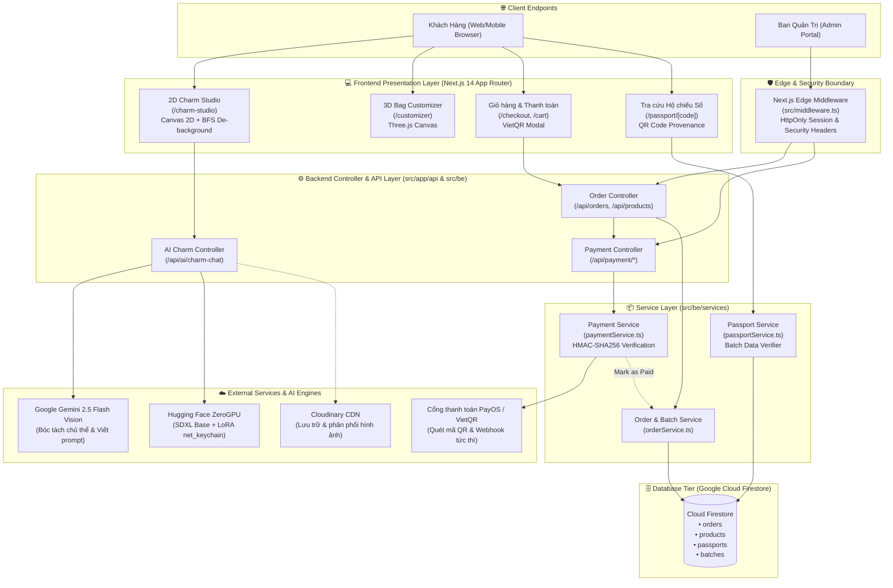

# 🏛️ VecomNet's System Architecture & Technical Specifications

> **Hệ thống Nền tảng Thương mại Điện tử Túi Lưới Đại Dương & Xưởng Chế Tác Móc Khoá 2D AI Độc Bản (Nét Studio)**  
> *Generated with [Archify](https://github.com/tt-a1i/archify) (Quality Profile: `showcase`, All gates passed: `validate`, `deliver`, `check`, `browser-check`).*

---

## 1. 🗺️ Sơ đồ Kiến trúc Tương tác (Interactive Archify Diagram)

File sơ đồ kiến trúc động chuẩn showcase đã được tạo tại:
- **Đường dẫn file:** [`docs/architecture/system_architecture.html`](file:///Users/3o/Documents/Study/Vecomnets/docs/architecture/system_architecture.html)
- **Tập tin định nghĩa nguồn:** [`.archify/architecture-vecomnets-sysarch/candidate.json`](file:///Users/3o/Documents/Study/Vecomnets/.archify/architecture-vecomnets-sysarch/candidate.json)

*(Bạn có thể mở trực tiếp file `system_architecture.html` trên bất kỳ trình duyệt nào để trải nghiệm sơ đồ tương tác đa luồng, hỗ trợ Dark/Light mode, phóng to/thu nhỏ, kiểm tra đường truyền dữ liệu và xuất ảnh SVG/PNG/WebM).*

---

## 2. 🧩 Kiến trúc Tổng thể Hệ thống (Mermaid Topology)



---

## 3. 🔍 Chi tiết Các Module Cốt lõi & Mã Nguồn (Source-Backed Components)

### 3.1. Frontend & Customizer Studio
- **[Charm Studio (`src/app/charm-studio/page.tsx`)](file:///Users/3o/Documents/Study/Vecomnets/src/app/charm-studio/page.tsx):**
  - Xưởng thiết kế móc khoá cá nhân hoá: Người dùng có thể điền ô trống (Chủ thể, Kiểu dáng, Màu sắc, Biểu cảm) hoặc tải ảnh đời thực (selfie, chân dung, thú cưng).
  - Tích hợp bộ xử lý xoá phông tự động trên Canvas phía Client ([`charmImageProcessor.ts`](file:///Users/3o/Documents/Study/Vecomnets/src/lib/charmImageProcessor.ts)) sử dụng thuật toán loang màu BFS từ 4 góc ảnh để biến nền trắng thành trong suốt mà không làm mất chi tiết viền die-cut của móc khoá.
- **[3D Bag Customizer (`src/app/customizer/page.tsx`)](file:///Users/3o/Documents/Study/Vecomnets/src/app/customizer/page.tsx):**
  - Trình dựng 3D thời gian thực hiển thị túi lưới tái chế đại dương (Three.js canvas), cho phép người dùng gắn phôi móc khoá 2D lên các chân cài (grid pins) của túi lưới.
- **[Digital Passport UI (`src/app/passport/[code]/page.tsx`)](file:///Users/3o/Documents/Study/Vecomnets/src/app/passport/[code]/page.tsx):**
  - Giao diện tra cứu hành trình túi lưới khi quét mã QR vật lý đính trên túi: Hiển thị toạ độ thu gom rác biển, cân nặng lưới tái chế, nghệ nhân chế tác và mã lô sản xuất.

### 3.2. Lớp Bảo mật & Edge Middleware
- **[Edge Middleware (`src/middleware.ts`)](file:///Users/3o/Documents/Study/Vecomnets/src/middleware.ts):**
  - Chặn các truy cập trái phép vào `/admin` và `/api/admin/*`.
  - Kiểm tra tính hợp lệ của token phiên `admin_session` bằng chữ ký HMAC-SHA256 kết hợp mã bí mật `ADMIN_SESSION_SECRET`.
  - Thiết lập bộ Security Headers chuẩn OWASP: `X-Frame-Options: DENY`, `X-Content-Type-Options: nosniff`, `Referrer-Policy: strict-origin-when-cross-origin`.
- **[Payment HMAC Verification (`src/be/services/paymentService.ts`)](file:///Users/3o/Documents/Study/Vecomnets/src/be/services/paymentService.ts):**
  - Xác minh toàn vẹn dữ liệu Webhook từ PayOS bằng khoá bí mật `PAYOS_CHECKSUM_KEY`, chống giả mạo trạng thái đơn hàng.

### 3.3. Pipeline AI Đồng sáng tạo Móc khoá 2D (Dual-AI Architecture)
- **[AI Route (`src/app/api/ai/charm-chat/route.ts`)](file:///Users/3o/Documents/Study/Vecomnets/src/app/api/ai/charm-chat/route.ts):**
  - **Giai đoạn 1 (Vision Intelligence):** Sử dụng `Google Gemini 2.5 Flash Vision` nhận diện ảnh người dùng tải lên. Gemini bóc tách toàn bộ đặc trưng nhân vật (tóc, kính mắt, râu, biểu cảm, trang phục, dáng đứng), đồng thời loại bỏ sạch sẽ bối cảnh phòng ốc, gương soi, tường nhà tắm và điện thoại trên tay.
  - **Giai đoạn 2 (Diffusion Generation):** Chuyển đoạn prompt đặc trưng đã chuẩn hoá sang mô hình chuyên dụng **LoRA `net_keychain`** chạy trên **Hugging Face ZeroGPU** (`StableDiffusionXLPipeline` SDXL Base 1.0).
  - Mô hình LoRA tạo ra bản vẽ phôi móc khoá 2D đơn lẻ, có đường viền đen đậm bo quanh thân (die-cut outline), mảng màu phẳng và đứng trên nền trắng tinh khiết tuyệt đối `#FFFFFF`.

### 3.4. Cơ sở Dữ liệu & Lưu trữ (Persistence Tier)
- **[Firebase Firestore Config (`src/be/config/firebase.ts`)](file:///Users/3o/Documents/Study/Vecomnets/src/be/config/firebase.ts):**
  - `orders`: Lưu trữ thông tin đơn hàng, danh sách item (túi + móc khoá đính kèm), địa chỉ giao hàng và trạng thái thanh toán (`pending`, `paid`, `processing`, `delivered`).
  - `products`: Danh mục sản phẩm túi lưới và phôi móc khoá tiêu chuẩn.
  - `passports`: Dữ liệu hộ chiếu số bảo chứng nguồn gốc rác thải đại dương cho từng chiếc túi.
  - `batches`: Thông tin lô sản xuất, số lượng rác thải đại dương được tái chế tương ứng.
  - `design_requests`: Nhật ký các yêu cầu thiết kế móc khoá 2D của khách hàng.

---

## 4. 🔄 Luồng Dữ liệu Trọng yếu (End-to-End Data Flows)

### 4.1. Luồng Sinh Móc Khoá 2D Cá Nhân Hoá từ Ảnh Khách Hàng
1. Khách hàng tải ảnh selfie hoặc chân dung tại `Charm Studio`.
2. Trình duyệt gửi ảnh dạng Base64 về `/api/ai/charm-chat`.
3. Server gửi ảnh tới **Google Gemini 2.5 Flash Vision**:
   - Phân tích diện mạo: *Chàng trai, tóc đen rẽ ngôi, đeo kính gọng vuông đen, râu quai nón, mặc áo phông đen cộc tay, quần kaki, tay đút túi quần*.
   - Khử bối cảnh: *Loại bỏ gương soi, nhà tắm, điện thoại cầm tay*.
   - Sinh đoạn Master Prompt tiếng Anh tiêu chuẩn cho xưởng in 3D:
     ```text
     net_keychain, a single isolated 2D flat die-cut acrylic charm of a cute chibi young man with short spiky black hair, rectangular glasses, neat goatee, black t-shirt and beige trousers, hand in pocket confident stance, thick bold black die-cut contour outline, vibrant flat colors, isolated on pure solid white #FFFFFF background, minimal vector sticker art, no background, no room, no mirror, no phone
     ```
4. Server gọi endpoint ZeroGPU trên Hugging Face Spaces:
   - Mô hình nạp LoRA `net_keychain_sdxl_lora.safetensors` và sinh ảnh 1024x1024.
5. Ảnh trả về Client -> `charmImageProcessor.ts` tự động bóc tách nền trắng -> Hiển thị phôi trong suốt gắn thử lên túi lưới 3D.

### 4.2. Luồng Đặt Hàng & Thanh Toán Tự Động VietQR
1. Khách hàng bấm **Thanh Toán** tại giỏ hàng.
2. Client gửi payload đơn hàng tới `/api/orders` -> `orderService` lưu Firestore với trạng thái `pending`.
3. Client gọi `/api/payment/create-qr` -> `paymentService` gọi **PayOS** sinh mã VietQR động chứa số tiền và nội dung chuyển khoản mã hoá mã đơn hàng.
4. Khách hàng quét mã trên App Ngân Hàng để chuyển tiền.
5. PayOS gửi Webhook về `/api/payment/payos-webhook` -> `paymentController` kiểm tra chữ ký HMAC SHA-256 -> `orderService` cập nhật trạng thái đơn hàng sang `paid`.
6. Client polling / lắng nghe real-time hiển thị màn hình chúc mừng và kích hoạt mã Hộ Chiếu Số cho sản phẩm.

---

## 5. 🛠️ Công Nghệ & Hạ Tầng (Tech Stack Summary)

| Phân hệ | Công nghệ sử dụng | Mục đích & Trách nhiệm |
| :--- | :--- | :--- |
| **Frontend Framework** | Next.js 14 (App Router), React 18, TypeScript | Render SSR/CSR, Responsive UI |
| **Styling & Icons** | Tailwind CSS, Lucide React | Giao diện hiện đại, tối ưu di động |
| **3D & 2D Graphics** | Three.js, HTML5 Canvas 2D, BFS Transparency | Hiển thị túi lưới 3D & xưởng móc khoá |
| **AI Vision** | Google Gemini 2.5 Flash Vision API | Phân tích ảnh, trích xuất nhận dạng |
| **AI Diffusion** | Stable Diffusion XL Base 1.0 + LoRA net_keychain | Sinh phôi móc khoá 2D độc bản |
| **AI Hosting** | Hugging Face Spaces (ZeroGPU Gradio 5 / FastAPI) | Hạ tầng GPU đám mây phục vụ inference |
| **Database** | Google Cloud Firestore (Firebase Admin SDK) | Lưu trữ NoSQL thời gian thực |
| **Payments** | PayOS SDK & VietQR Gateway | Thanh toán ngân hàng tự động 24/7 |
| **Media CDN** | Cloudinary API | Lưu trữ ảnh thiết kế & tải lên |
| **Architecture Engine** | Archify v3.2.0 | Xây dựng sơ đồ kiến trúc chuẩn mã nguồn |
